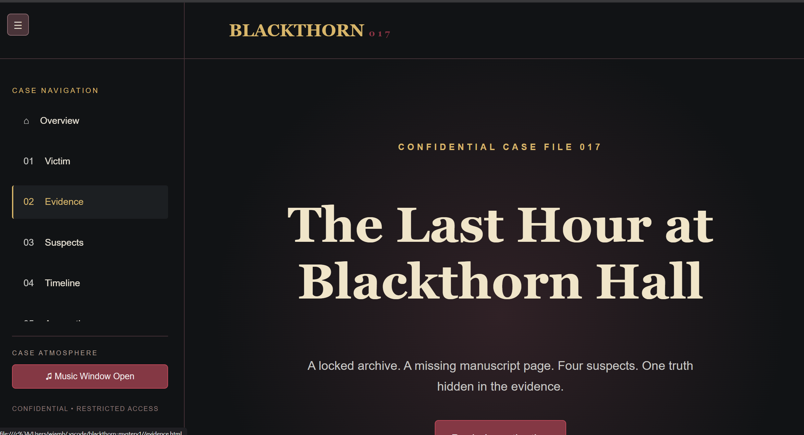
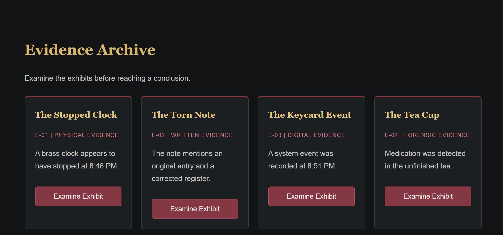
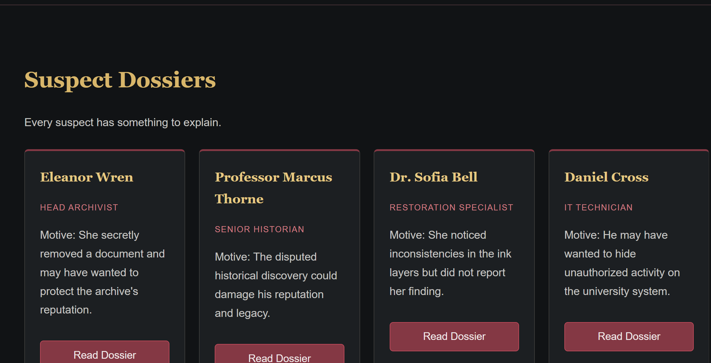
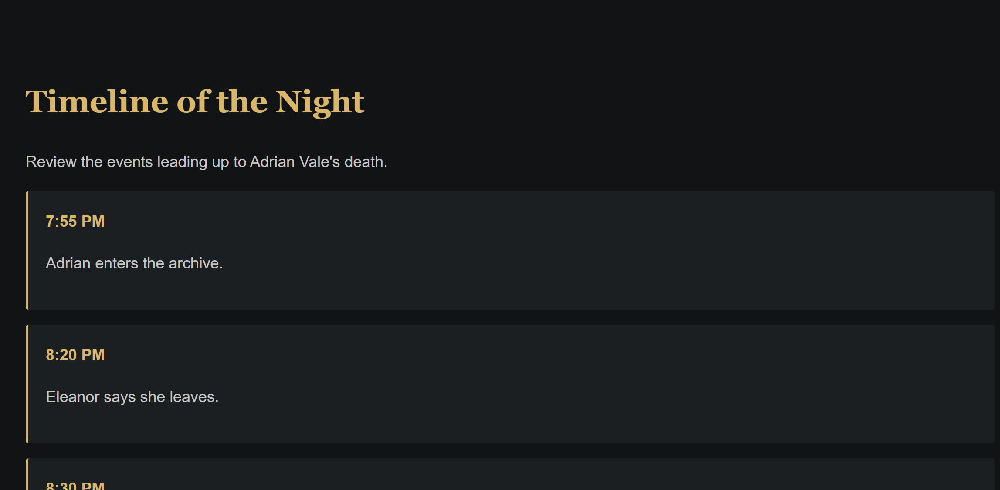
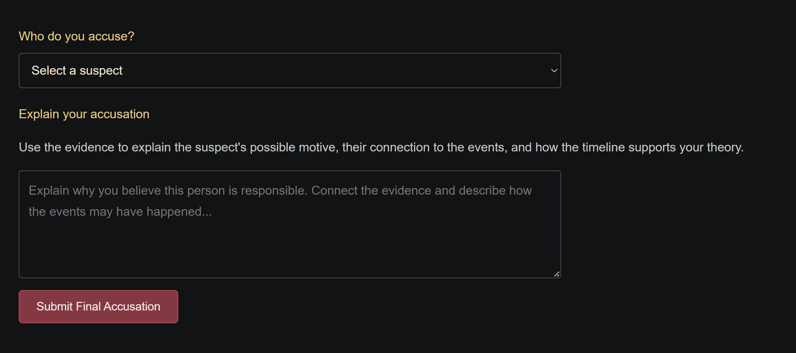

# 🕵️ Blackthorn Hall: Case File 017
### An Interactive Mystery Investigation Website

> A locked archive. A missing manuscript page. Four suspects. One truth hidden in the evidence.

## 📖 About the Project

Blackthorn Hall: Case File 017 is an interactive mystery investigation website developed as part of a university Web Development project.

The website allows users to investigate a fictional murder case, examine evidence, explore suspect profiles, follow an investigation timeline, and submit their final accusation.

The project combines mystery storytelling with interactive web development to create an engaging investigative experience.

## 🎯 Project Objectives

- Develop an interactive website using HTML, CSS, and JavaScript.
- Practice front-end web development and DOM manipulation.
- Create an engaging user experience through interactive elements.
- Organize information into multiple investigation sections.
- Apply programming concepts to a practical web development project.

## ✨ Features

- **Case Briefing:** Introduction to the Blackthorn Hall investigation.
- **Evidence Examination:** Interactive evidence exhibits and investigation details.
- **Suspect Dossiers:** Detailed profiles of the four suspects.
- **Investigation Timeline:** A chronological presentation of important events.
- **Accusation System:** Allows users to select a suspect and submit their reasoning.
- **Interactive Navigation:** Navigate between different sections or page views.
- **Visual Design:** A dark investigative theme with coordinated colors and interface elements.

## 👥 The Suspects

The investigation introduces four suspects:

1. Eleanor Wren – Head Archivist
2. Marcus Thorne – Senior Historian
3. Sofia Bell – Restoration Specialist
4. Daniel Cross – IT Technician

## 🛠️ Technologies Used

| Technology | Purpose |
|------------|---------|
| HTML5      | Website structure |
| CSS3       | Styling and layout |
| JavaScript | Interactive functionality |
| Vs Code    | Development environment |
| Live Server| Local website testing |

## 📸 Project Screenshots

### Main Investigation Interface

### Evidence Examination

### Suspect Dossiers

### Investigation Timeline

### Investigation Aacusation

## 🚀 How to Run the Project

1. Download or clone this repository.
2. Open the project folder in Visual Studio Code.
3. Install the Live Server extension if it is not already installed.
4. Open the main `index.html` file.
5. Right-click and select **Open with Live Server**.
6. Explore the investigation through the website navigation.

## 📂 Project Structure

The project contains HTML, CSS, JavaScript, and supporting media files.

The main files include:

- `index.html` – Main website entry point.
- `style1.css` – Website styling.
- `script1.js` – Interactive functionality.
- `screenshot-` – Images used to showcase the project in this README.
- `detective-music.mp3` – includes the music used in the project.

## 📚 Academic Project

Developed as an individual university Web Development project.

**Project:** Blackthorn Hall: Case File 017  
**Student:** Wiam Bidane  
**University:** Nanjing Tech University

---

*An interactive mystery where every piece of evidence matters. Can you uncover the truth behind Blackthorn Hall?*
